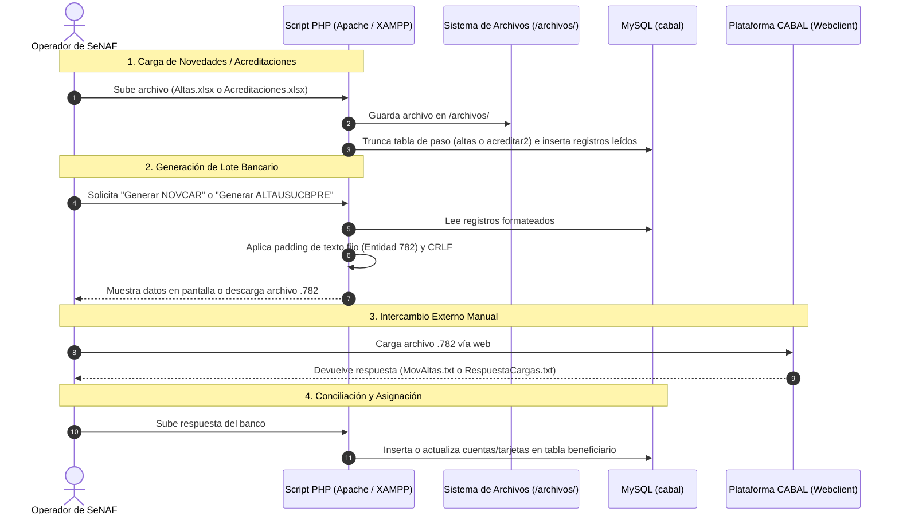

# Documento de Arquitectura de Software

**Proyecto:** Sistema de Gestión de Tarjetas Sociales Cabal (Familia Rionegrina Solidaria - FSR / SeNAF)  
**Ubicación en Servidor:** `/opt/lampp/htdocs/cabal-Gemini`  
**Entorno de Ejecución:** Servidor local Linux (Ubuntu x86_64) sobre stack XAMPP/LAMPP  
**Fecha de Auditoría:** 20 de Octubre de 2026  
**Auditoría y Diagnóstico:** Arquitectura de Software y Seguridad  

---

## 1. Resumen Ejecutivo y Diagnóstico General

El sistema es una aplicación monolítica procedimental desarrollada en **PHP** orientada a la administración operativa de tarjetas de débito/sociales emitidas bajo convenio con **CABAL (Entidad 782)** en el marco del programa social provincial *Familia Rionegrina Solidaria* (FSR / Secretaría de Niñez, Adolescencia y Familia - SeNAF, Río Negro).

La aplicación actúa fundamentalmente como un **puente de intercambio y conciliación de archivos batch** entre:
1. Las planillas de cálculo internas (`.xlsx` provistas por Suministros o áreas sociales).
2. La base de datos relacional MySQL/MariaDB (`cabal`).
3. El mainframe / plataforma bancaria de intercambio de CABAL (`https://transmisiones.cabal.coop`).

---

## 2. Stack Tecnológico Comprobado y Estado de Dependencias

| Componente | Versión Comprobada en Servidor | Estado / Observación | Evidencia |
| :--- | :--- | :--- | :--- |
| **Sistema Operativo** | Linux Ubuntu x86_64 (Kernel 7.0.0-38-generic) | Host: `Informatica02-SeNAF` | `uname -a` |
| **Servidor Web** | Apache 2.4.38 (Unix) | Integrado en suite XAMPP (`/opt/lampp`) | `apachectl -v` |
| **Motor PHP (Web)** | PHP 5.6.40 (cli / mod_php) | **OBSOLETO / EOL (Diciembre 2018)**. Riesgo crítico de seguridad. | `/opt/lampp/bin/php -v` |
| **Motor PHP (Sistema Host)** | PHP 8.5.4 (cli) Ubuntu | Instalado en el sistema base, pero sin driver MySQL PDO activo para CLI estándar. | `php -v` |
| **Base de Datos** | MySQL / MariaDB 10.x | Base de datos activa: `cabal` en `localhost:3306` | `inspect_db.php` |
| **Librería Excel** | PHPExcel v1.8.x (`phpoffice/phpexcel`) | **ABANDONADA en 2017**. Incompatible con PHP 8+. Requiere migración a `PhpSpreadsheet`. | `phpexcel/composer.json:L2` |
| **Framework Frontend** | Bootstrap 3.x / 5.3.3 (Heterogéneo) | Coexisten bundles locales en `Bootstrap/` y CDNs externos de Bootstrap 5. | `index.php`, `subir_excel_altas.php:L52` |
| **Gestor de Paquetes** | Ninguno en raíz | No existen `composer.json` ni `package.json` en la raíz. | Inspección de raíz |

---

## 3. Topología y Estructura de Directorios

```text
/opt/lampp/htdocs/cabal-Gemini/
├── index.php                          # Panel principal y menú de navegación
├── index-menu.html / menu.php         # Menús alternativos / legados
├── index_old.php / ayuda_old.html     # Versiones antiguas del sistema
├── ayuda.html                         # Documentación operativa de flujos Cabal
├── BD/                                # Capa de datos e utilidades SQL
│   ├── BD.php                         # Funciones de consulta y helpers PDO/mysqli
│   ├── Funciones.php                  # Funciones de formateo de texto, CUIT, DNI y montos
│   ├── UsarGestion.php                # Instanciación PDO compartida
│   └── info.php                       # Llamada a phpinfo() [RIESGO DE EXPOSICIÓN]
├── archivos/                          # [Eliminado en working copy / previsto en git]
│   └── (Archivos batch de entrada y salida: .xlsx, .txt, .782)
├── Novcar/                            # Salida y verificación del archivo NOVCAR.782
│   ├── novcar.782                     # Archivo batch generado para cargas
│   └── EsteArchivo.txt
├── Bootstrap/                         # Librería local Bootstrap CSS/JS
├── css/ / img/                        # Hojas de estilo y recursos gráficos
├── phpexcel/                          # Librería PHPExcel 1.8 embebida manualmente
├── V2/                                # Prototipo modular mejorado (Altas.php con salida directa)
├── Crud2/                             # Prototipo CRUD de beneficiarios (incompleto)
├── crud/                              # CRUD básico de beneficiarios con DataTables
├── crud-acreditacion/                 # Módulo de acreditación manual AJAX (v1, v2, v3, gemin)
└── uploads/                           # Directorio auxiliar de subidas temporales
```

---

## 4. Patrón de Diseño y Ciclo de Vida de Petición (Request Lifecycle)

### 4.1. Patrón Arquitectónico Actual
El sistema implementa un patrón **Script-per-Action (Monolito Procedimental Directo)** sin enrutador central ni arquitectura MVC:
- Cada archivo `.php` en la raíz representa a la vez el controlador, la lógica de negocio y la vista HTML.
- No hay separación de capas (los scripts abren conexiones directas a MySQL con credenciales hardcodeadas, ejecutan consultas SQL, procesan archivos binarios de Excel y generan el marcado HTML en el mismo archivo).
- La invocación se realiza por acceso directo a los scripts mediante URLs planas (`/AcreditarSaldos2026.php`, `/GenerarCargaCredito2026.php`).

### 4.2. Flujo del Ciclo de Vida de una Transacción Típica



---

## 5. Puntos de Integración del Sistema

### 5.1. Integración Externa: Plataforma CABAL (Entidad 782)
El sistema opera con formatos de archivo de ancho fijo definidos por las especificaciones de Cabal para entidades financieras:

1. **ALTAUSUCBPRE.782 (Altas de Usuarios de Tarjetas Precargadas):**
   - **Estructura:** 3 registros de 128 bytes por cada usuario (`TE01...01`, `TE01...02`, `TE01...03`).
   - **Destino:** Subida manual a `https://transmisiones.cabal.coop`.
   - **Retorno:** Archivo de confirmación tipo `782_out_altas_tpc_YYYYMMDD_XXXX_XXXXXX.txt` (procesado internamente como `MovAltas.txt`), el cual asigna `NumeroCuenta` y `NumeroTarjeta`.

2. **NOVCAR.782 (Novedades de Carga de Crédito / Acreditaciones):**
   - **Estructura:** Encabezado `TE04782000...`, registros de detalle de 80 bytes (código operación `6339`, importe en centavos padded a 9 dígitos), y registro trailer `TE04782000...` con sumatoria de montos e ítems.
   - **Retorno:** Archivo `782_RCAR_YYYYMMDD_...txt` (procesado como `RespuestaCargas.txt`).

3. **NOVTRAN.782 / NOVDES (Descarga / Débito de Saldos):**
   - **Estructura:** Registros `TE04` con código de operación `62` (descarga/débito). Generado en `cereo_upload.php` y `generar_novdes.php`.

4. **Movimientos.txt (Liquidación Mensual de Consumos Cabal):**
   - **Estructura:** Archivo de texto posicional descargado el último día hábil de cada mes (`782_Nacion_YYYYMMDD_...txt`). Alimenta la tabla `movimientos`.

5. **MAESPLA.txt (Maestro de Plásticos):**
   - **Estructura:** Padrón general de plásticos emitidos, fechas de alta, emisión y vencimiento (`MasterTarjetas`).

### 5.2. Integración Interna: Planillas de Cálculo (Excel)
- Lectura de archivos `.xlsx` y `.xls` mediante la biblioteca PHPExcel.
- Dependencia crítica de la disposición posicional exacta de columnas en los archivos de origen provistos por el área de Suministros (ej. fila 6 de inicio, columna 6 para CUIT, columna 7 para Monto).

---

## 6. Brechas Arquitectónicas Identificadas

1. **Ausencia de Capa de Abstracción de Base de Datos Centralizada:**
   - Hay más de 15 archivos que instancian conexiones `new mysqli()` o `new PDO()` de forma redundante e independiente, repitiendo usuario y contraseña en código.
2. **Dependencia de Intervención Manual en Windows:**
   - La falta de normalización de saltos de línea (`\r\n`) en scripts antiguos forzaba al operador a copiar texto de la pantalla web a Notepad++ en Windows para generar los archivos bancarios.
3. **Falta de Control Transaccional:**
   - Procesos que truncan tablas (`TRUNCATE TABLE acreditar2`) antes de insertar filas de Excel no utilizan transacciones (`BEGIN/COMMIT/ROLLBACK`). Si una fila falla en la mitad del archivo, los datos previos quedan destruidos y el lote a medio procesar.
4. **Acoplamiento de Versiones por PHPExcel:**
   - El uso de PHPExcel bloquea la migración del servidor a versiones soportadas de PHP (PHP 8.x).
