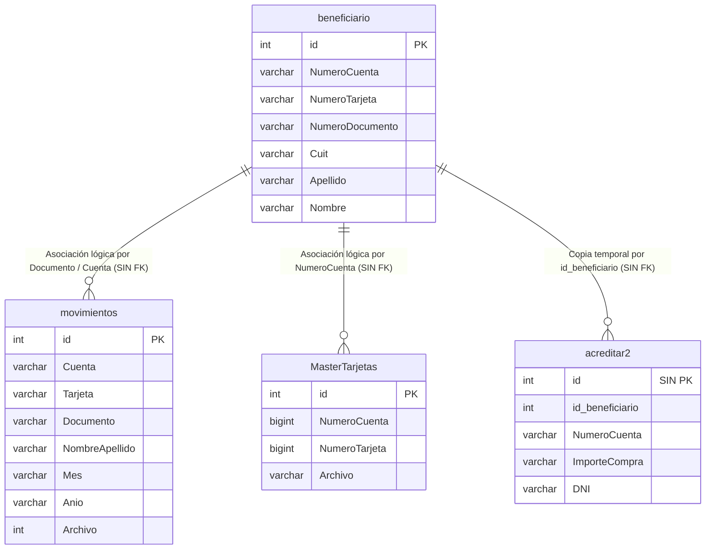

# Auditoría de Base de Datos y Modelo Relacional

**Base de Datos Auditada:** `cabal`  
**Motor:** MySQL / MariaDB (vía XAMPP en `localhost:3306`)  
**Fecha de Inspección:** 20 de Octubre de 2026  
**Método de Inspección:** Consultas de metadatos en vivo vía PDO (`SHOW TABLES`, `DESCRIBE`, `SHOW INDEX`) y análisis estático de consultas SQL en código fuente.

---

## 1. Inventario General de Tablas

La base de datos activa contiene **7 tablas reales**. Adicionalmente, el código fuente hace referencia a **1 tabla inexistente** (`otra_tabla`) producto de prototipos no consolidados.

| Nombre de Tabla | Cantidad de Columnas | Clave Primaria | Total Registros Activos | Tipo / Propósito Principal |
| :--- | :---: | :---: | :---: | :--- |
| `beneficiario` | 25 | `id` (auto_increment) | 163 | **Entidad Maestra:** Padrón consolidado de titulares de tarjeta y cuentas |
| `movimientos` | 18 | `id` (auto_increment) | 7.635 | **Transaccional:** Histórico de consumos mensuales reportados por Cabal |
| `MasterTarjetas`| 11 | `id` (auto_increment) | 444 | **Catálogo:** Registro de plásticos emitidos (MAESPLA) |
| `altas` | 19 | `id` (auto_increment) | 1 | **Tabla de Paso / Staging:** Carga temporal de altas desde Excel |
| `acreditar` | 10 | **NINGUNA (Falta PK)** | 26 | **Tabla de Paso:** Lote temporal de acreditaciones (versión 2023) |
| `acreditar2` | 10 | **NINGUNA (Falta PK)** | 29 | **Tabla de Paso:** Lote temporal de acreditaciones (versión 2026) |
| `acreditarmanual`| 10 | `id` (auto_increment) | 4 | **Tabla de Paso:** Lote generado desde módulo web manual |
| `otra_tabla` | — | — | *No existe en BD* | *Referencia rota en `crud-acreditacion/v2/grabar_beneficiario.php:L27`* |

---

## 2. Diccionario de Datos Detallado

### 2.1. Tabla: `beneficiario` (Padrón Central)
Almacena los datos personales, de contacto y bancarios de cada titular de la tarjeta social.

| Campo | Tipo SQL | Null | Default | Índice / Clave | Observación Técnica |
| :--- | :--- | :---: | :---: | :---: | :--- |
| `id` | `int(11)` | NO | auto_increment | **PRI** / MUL | Clave primaria. Posee además un índice redundante no-único `id`. |
| `Apellido` | `varchar(45)` | YES | NULL | — | Texto simple |
| `Nombre` | `varchar(45)` | YES | NULL | — | Texto simple |
| `Calle` | `varchar(45)` | YES | NULL | — | Domicilio |
| `Numero` | `varchar(45)` | YES | NULL | — | Altura / número de calle |
| `Piso` | `varchar(45)` | YES | NULL | — | Piso depto |
| `Departamento` | `varchar(45)` | YES | NULL | — | Letra / número depto |
| `Localidad` | `varchar(45)` | YES | NULL | — | Localidad de Río Negro |
| `Provincia` | `varchar(45)` | YES | NULL | — | Código o nombre provincia |
| `Sexo` | `varchar(45)` | YES | NULL | — | F / M |
| `EntidadEmisora` | `varchar(45)` | YES | NULL | — | Habitualmente `782` (Cabal) |
| `FechaProceso` | `varchar(45)` | NO | NULL | — | Almacenado como texto en lugar de `date` |
| `NumeroCuenta` | `varchar(45)` | YES | NULL | — | Cuenta Cabal (crucial para asignación de cargas) |
| `NumeroTarjeta` | `varchar(45)` | YES | NULL | — | Número de tarjeta de 16 dígitos |
| `CodigoPostal` | `varchar(45)` | YES | NULL | — | Código postal |
| `TelefonoCaracteristica` | `varchar(45)` | YES | NULL | — | Prefijo telefónico |
| `TelefonoNumero` | `varchar(45)` | YES | NULL | — | Número telefónico |
| `EstadoCivil` | `varchar(45)` | YES | NULL | — | Estado civil |
| `FechaNacimiento` | `varchar(45)` | YES | NULL | — | Almacenado como texto en lugar de `date` |
| `TipoDocumento` | `varchar(45)` | YES | NULL | — | DNI / LC / LE / CI |
| `NumeroDocumento` | `varchar(45)` | YES | NULL | — | **Sin índice único.** Riesgo de registros duplicados |
| `ProvinciaDocumento` | `varchar(45)` | YES | NULL | — | Código de provincia |
| `Cuit` | `varchar(45)` | YES | NULL | — | **Sin índice único.** Utilizado en búsquedas `WHERE Cuit = ?` |
| `CodigoIngreso` | `varchar(45)` | YES | NULL | — | Código devuelto por Cabal |
| `CodigoRechazo` | `varchar(45)` | YES | NULL | — | Código de motivo de rechazo |

---

### 2.2. Tabla: `movimientos` (Historial de Transacciones)
Contiene las líneas de detalle de consumos y movimientos liquidados por mes/año para cada cuenta.

| Campo | Tipo SQL | Null | Default | Clave | Observación Técnica |
| :--- | :--- | :---: | :---: | :---: | :--- |
| `id` | `int(11)` | NO | auto_increment | **PRI** | Clave primaria |
| `Banco` | `varchar(50)` | NO | NULL | — | Código Banco (ej. 782) |
| `Sucursal` | `varchar(50)` | NO | NULL | — | Código sucursal |
| `Cuenta` | `varchar(50)` | NO | NULL | — | Número de cuenta |
| `Tarjeta` | `varchar(50)` | NO | NULL | — | Número de tarjeta |
| `TipoDocumento` | `varchar(50)` | NO | NULL | — | Tipo de documento |
| `Documento` | `varchar(50)` | NO | NULL | — | **Sin índice.** Filtrado en `consultaMovimientoPorDNI.php` |
| `NombreApellido`| `varchar(50)` | NO | NULL | — | **Sin índice.** Filtrado en `consultaMovimientoPorNombre.php` |
| `CodigoOperacion`| `varchar(50)` | NO | NULL | — | "SALDO INICIAL", "SALDO FINAL", "AUTORIZACIONES", etc. |
| `Fecha` | `varchar(50)` | NO | NULL | — | Fecha de consumo en texto |
| `Comercio` | `varchar(50)` | NO | NULL | — | Nombre del comercio |
| `Importe` | `varchar(50)` | NO | NULL | — | Monto como texto (debería ser `decimal(12,2)`) |
| `Signo` | `varchar(50)` | NO | NULL | — | Signo del movimiento (+ / -) |
| `Importe2` | `varchar(50)` | NO | NULL | — | Campo de importe alternativo |
| `Signo2` | `varchar(5)` | NO | NULL | — | Signo secundario |
| `Mes` | `varchar(50)` | NO | NULL | — | **Sin índice.** Filtrado en `consultaMovimiento.php` |
| `Anio` | `varchar(50)` | NO | NULL | — | **Sin índice.** Filtrado en `consultaMovimiento.php` |
| `Archivo` | `int(11)` | NO | NULL | — | **Sin índice.** Identificador del lote cargado |

---

### 2.3. Tabla: `MasterTarjetas` (Padrón de Plásticos)
Padrón maestro de plásticos emitidos según archivos `MAESPLA`.

| Campo | Tipo SQL | Null | Default | Clave |
| :--- | :--- | :---: | :---: | :---: |
| `id` | `int(11)` | NO | auto_increment | **PRI** |
| `NumeroCuenta` | `bigint(20)` | NO | NULL | — |
| `NumeroTarjeta`| `bigint(20)` | NO | NULL | — |
| `NombreApellido`| `varchar(100)`| NO | NULL | — |
| `TipoDocumento`| `int(11)` | NO | NULL | — |
| `NroDocumento` | `bigint(20)` | NO | NULL | — |
| `Causa` | `varchar(25)` | NO | NULL | — |
| `FechaAlta` | `date` | NO | NULL | — |
| `FechaEmision` | `date` | NO | NULL | — |
| `FechaVencimiento`| `date` | NO | NULL | — |
| `Archivo` | `varchar(100)`| NO | NULL | — |

---

### 2.4. Tablas de Lote de Acreditación (`acreditar`, `acreditar2`, `acreditarmanual`)
Tablas de pasaje usadas para armar los lotes de `NOVCAR.782`.

- **Columnas:** `id` (int), `id_beneficiario` (int), `Apellido` (varchar 50), `Nombre` (varchar 50), `NumeroCuenta` (varchar 50), `ImporteCompra` (varchar 50), `ImporteCajero` (varchar 50), `DNI` (varchar 50), `Fecha` (varchar 50), `Hora` (varchar 50).
- **Hallazgo Crítico de Integridad:** En `acreditar` y `acreditar2` **NO EXISTE CLAVE PRIMARIA** ni índices (`SHOW INDEX` devuelve vacío). Se truncan por completo con `TRUNCATE TABLE` en cada ejecución (`AcreditarSaldos2026.php:L23`).

---

## 3. Análisis de Relaciones y Restricciones de Integridad



### 3.1. Estado de Restricciones
1. **Claves Foráneas (Foreign Keys): CERO (0).** No hay ninguna restricción referencial activa en la base de datos. Si se elimina un beneficiario en `beneficiario`, sus registros en `movimientos` quedan huérfanos.
2. **Restricciones UNIQUE: CERO (0).** Ninguna columna tiene restricción `UNIQUE`. El sistema depende exclusivamente de comprobaciones en PHP (`EstaDNI()`), lo que genera condiciones de carrera (Race Conditions) y riesgo de duplicación.
3. **Índice Redundante en `beneficiario`:** La tabla tiene la clave primaria `PRIMARY` en `id` y además un índice no único denominado `id` sobre la misma columna `id`, consumiendo espacio y overhead de inserción innecesario.

---

## 4. Auditoría de Consultas SQL Críticas

### 4.1. Consultas Vulnerables por Concatenación Directa (SQL Injection)

1. **`BD/BD.php:L50` y `L202`:**
   ```php
   $sql = "SELECT id FROM beneficiario WHERE NumeroDocumento = $DNI LIMIT 1;";
   $sql = "SELECT * FROM beneficiario WHERE NumeroDocumento =$DNI;";
   ```
2. **`consultaMovimientoPorDNI.php:L33`:**
   ```php
   $sql = "SELECT * FROM movimientos WHERE Documento = '$DNI'";
   ```
3. **`consultaMovimientoPorNombre.php:L33`:**
   ```php
   $sql = "SELECT * FROM movimientos WHERE NombreApellido = '$NombreApellido'";
   ```
4. **`crud/index.php:L14` y `crud/edit.php:L52`:**
   ```php
   $conexion->query("DELETE FROM beneficiario WHERE id = $id");
   $conexion->query("UPDATE beneficiario SET Apellido = '$apellido', Nombre = '$nombre' WHERE id = $id");
   ```
5. **`crud-acreditacion/grabar_beneficiario.php:L21`:**
   ```php
   $sql = "INSERT INTO acreditarmanual (id,id_beneficiario, Apellido, Nombre, NumeroCuenta, ImporteCompra, ImporteCajero, DNI, Fecha, Hora) 
           VALUES ('$id','$id_beneficiario', '$Apellido', '$Nombre', '$NumeroCuenta', '$ImporteCompra', '$ImporteCajero', '$DNI', '$Fecha', '$Hora')";
   ```

### 4.2. Consultas con Defectos Lógicos Graves en `BD/BD.php`

1. **`EstaFechaMovimiento()` (`BD/BD.php:L78-L98`):**
   ```php
   function EstaFechaMovimiento ($Mes,$Anio,$Archivo){
       require_once("BD/Funciones.php");
       CompletarNumeroDocumento($DNI); // <-- ERROR: $DNI no está definido en el ámbito
       $sentencia = $conn->prepare("SELECT id FROM movimientos WHERE Mes='".$Mes. "' AND Anio='".$Anio."' AND Archivo='".$Archivo."';");
       $sentencia->execute([$DNI]); // <-- ERROR: Ejecuta con [$DNI] pero la query no tiene placeholders '?'
   ```
   *Impacto:* Si PHP estuviera configurado con manejo estricto de excepciones PDO, este método lanzaría un `PDOException` fatal cada vez que se verifica un archivo de movimientos.

2. **`DevuelvoNumeroCuentaX()` (`BD/BD.php:L99-L118`):**
   ```php
   function DevuelvoNumeroCuentaX ($DNI,$CUIT){
       $sentencia = $conn->prepare("SELECT id FROM movimientos WHERE Mes='".$Mes. "' AND Anio='".$Anio."';");
       $sentencia->execute([$DNI]);
   ```
   *Impacto:* Función con código copiado erróneamente. Recibe DNI y CUIT pero consulta la tabla `movimientos` filtrando por `$Mes` y `$Anio` (que son variables no declaradas).

---

## 5. Oportunidades Críticas de Indexación y Rendimiento

Con 7.635 registros en `movimientos` y consultas constantes mediante filtros combinados, **la ausencia total de índices secundarios degrada el rendimiento (Full Table Scans obligatorios en cada búsqueda)**.

### Índices Faltantes Prioritarios para Sprint 2:
```sql
-- 1. Indexación para la tabla de movimientos (consultas por mes/año/archivo y búsquedas por persona)
ALTER TABLE `movimientos` ADD INDEX `idx_mov_periodo` (`Anio`, `Mes`, `Archivo`);
ALTER TABLE `movimientos` ADD INDEX `idx_mov_documento` (`Documento`);
ALTER TABLE `movimientos` ADD INDEX `idx_mov_nombre` (`NombreApellido`);

-- 2. Restricciones e índices en la tabla maestra de beneficiarios
ALTER TABLE `beneficiario` DROP INDEX `id`; -- Eliminar índice redundante
ALTER TABLE `beneficiario` ADD UNIQUE INDEX `uniq_benef_cuit` (`Cuit`);
ALTER TABLE `beneficiario` ADD INDEX `idx_benef_doc` (`NumeroDocumento`);
ALTER TABLE `beneficiario` ADD INDEX `idx_benef_cuenta` (`NumeroCuenta`);

-- 3. Claves primarias para tablas de lote
ALTER TABLE `acreditar` ADD PRIMARY KEY (`id_beneficiario`);
ALTER TABLE `acreditar2` ADD PRIMARY KEY (`id_beneficiario`);
```
