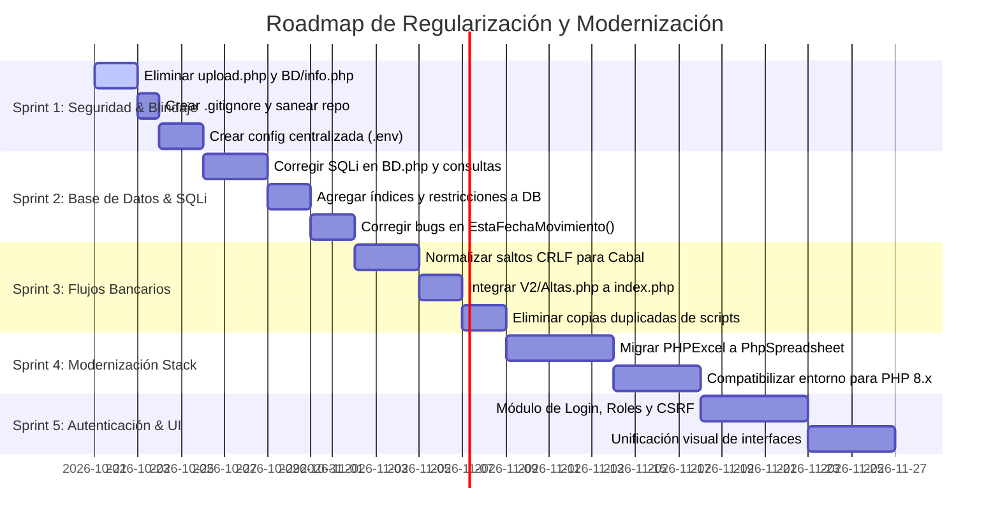

# Inventario de Pendientes, Deuda Técnica y Backlog Priorizado

**Proyecto:** Sistema Cabal - Familia Rionegrina Solidaria (FSR / SeNAF)  
**Fecha de Auditoría:** 20 de Octubre de 2026  
**Responsable:** Arquitectura de Software y Seguridad  

---

## 1. Inventario de Código Muerto, Duplicado y Prototipos Huérfanos

La inspección del repositorio identificó una gran cantidad de archivos duplicados manualmente (copias de seguridad "al vuelo"), prototipos no integrados y scripts de prueba en la raíz:

### 1.1. Archivos Duplicados y Versiones Anteriores (Archivos "Copy / Old / Previo")
| Archivo Duplicado | Archivo Oficial / Activo | Diagnóstico y Acción Recomendada |
| :--- | :--- | :--- |
| `AcreditarSaldos-2023 copy.php` (194 líneas) | `AcreditarSaldos2026.php` | **Eliminar.** Copia manual de seguridad de la versión 2023. |
| `AcreditarSaldos-2023.php` (184 líneas) | `AcreditarSaldos2026.php` | **Eliminar / Archivar.** Versión previa que operaba sobre `acreditar`. |
| `AcreditarSaldos.php` (174 líneas) | `AcreditarSaldos2026.php` | **Eliminar.** Duplicado de la versión de acreditación. |
| `AcreditarSaldo2026.php` (174 líneas) | `AcreditarSaldos2026.php` | **Consolidar.** Mismo archivo con nombre en singular. |
| `CargaTarjetaDeExcelBD copy.php` (137 líneas) | `CargaTarjetaDeExcelBD.php` | **Eliminar.** Copia manual de script de carga. |
| `ProcesarCSVAcreditacion copy.php` (115 líneas)| `ProcesarCSVAcreditacion.php` | **Eliminar.** Copia manual de script CSV. |
| `ProcesarMovimientos2 copy.php` (153 líneas) | `ProcesarMovimientos2.php` | **Eliminar.** Copia manual de lectura de movimientos. |
| `ProcesarMovimientos2Previo27Junio2024.php` (149 l.)| `ProcesarMovimientos2.php` | **Archivar.** Versión congelada de junio 2024. |
| `VerificarNovcar copy.php` (283 líneas) | `VerificarNovcar.php` | **Eliminar.** Copia manual de verificador de NOVCAR. |
| `index-2.html`, `index-menu.html`, `index_old.php` | `index.php` | **Consolidar.** Menús y maquetas viejas sin uso. |
| `ayuda_old.html` (109 líneas) | `ayuda.html` | **Eliminar.** Versión antigua del archivo de ayuda. |

### 1.2. Scripts de Prueba y Depuración en la Raíz
- `test.php`: Script de prueba con llamadas de prueba comentadas.
- `prueba.php` y `prueba2.php`: Pruebas de conectividad y formateo.
- `pruebaPDO.php`: Inserción de prueba en tabla `Prueba`.
- `BD/Funciones.test.php`: Archivo vacío (0 bytes).
- `BD/info.php`: Contiene llamada `phpinfo()`. **Riesgo crítico de exposición de entorno.**

### 1.3. Prototipos Rotos o Incompletos
- `Crud2/delete.php`: Código roto (`$id = $_POST['id']` pero se llama por enlace `GET`).
- `crud-acreditacion/v2/grabar_beneficiario.php`: Intenta insertar en tabla inexistente `otra_tabla`.
- `crud-acreditacion/gemin/` y `crud-acreditacion/gemin/chatgpt/`: Carpetas con experimentos y pruebas aisladas.

---

## 2. Matriz de Hallazgos de Seguridad (OWASP Top 10)

### 🔴 NIVEL CRÍTICO (Atención Inmediata)

#### SEC-01: Ejecución Remota de Código Arbitrario (RCE) por Subida de Archivos
- **Ubicación:** `upload.php:L24-L27`
- **Evidencia:**
  ```php
  $directorio = 'archivos/';
  $subir_archivo = $directorio.basename($_FILES['subir_archivo']['name']);
  if (move_uploaded_file($_FILES['subir_archivo']['tmp_name'], $subir_archivo)) {
  ```
- **Riesgo:** No existe validación de extensión, tipo MIME ni autenticación. Un usuario malintencionado puede subir `shell.php` a la carpeta `archivos/` y tomar control total del servidor web con los privilegios de Apache.
- **Acción:** Desactivar o eliminar `upload.php` inmediatamente e implementar listas blancas estrictas de extensiones (`.xlsx`, `.txt`).

#### SEC-02: Inyecciones SQL (SQL Injection - CWE-89) Múltiples
- **Ubicación:** 
  - `BD/BD.php:L50`: `SELECT id FROM beneficiario WHERE NumeroDocumento = $DNI LIMIT 1;`
  - `BD/BD.php:L202`: `SELECT * FROM beneficiario WHERE NumeroDocumento =$DNI;`
  - `consultaMovimientoPorDNI.php:L33`: `SELECT * FROM movimientos WHERE Documento = '$DNI'`
  - `consultaMovimientoPorNombre.php:L33`: `SELECT * FROM movimientos WHERE NombreApellido = '$NombreApellido'`
  - `crud/index.php:L14`: `DELETE FROM beneficiario WHERE id = $id`
  - `crud/edit.php:L52`: `UPDATE beneficiario SET Apellido = '$apellido', Nombre = '$nombre' WHERE id = $id`
  - `crud-acreditacion/grabar_beneficiario.php:L21`: Variables POST concatenadas directamente en `INSERT INTO acreditarmanual`.
  - `Crud2/delete.php:L12`: `DELETE FROM beneficiario WHERE id=$id`
- **Riesgo:** Extracción completa de la base de datos de beneficiarios, alteración de saldos o borrado arbitrario de tablas mediante inyecciones en parámetros GET o POST.
- **Acción:** Migrar todas las consultas a Prepared Statements parametrizados con PDO o MySQLi (`bind_param`).

#### SEC-03: Exposición de Información Financiera y PII sin Autenticación
- **Ubicación:** Todo el sistema (`index.php`, `ExportarExcelBeneficiarios.php`, `ConsultaBenefiario2.php`)
- **Riesgo:** El sistema carece de módulo de login, sesiones o control de roles. Cualquier usuario conectado a la red local puede ver, exportar o eliminar datos sensibles de beneficiarios (Nombres, DNI, CUIT, Número de Tarjeta y Cuentas bancarias).
- **Acción:** Implementar un middleware o control de sesión obligatorio para todas las rutas.

---

### 🟠 NIVEL ALTO

#### SEC-04: Divulgación de Información del Servidor (CWE-200)
- **Ubicación:** `BD/info.php:L2` (`phpinfo();`)
- **Riesgo:** Expone la configuración de Apache, variables de entorno, rutas absolutas, módulos cargados y versiones vulnerables de software a cualquier visitante web.
- **Acción:** Eliminar `BD/info.php`.

#### SEC-05: Credenciales de Base de Datos en Texto Plano en Código Fuente
- **Ubicación:** Presente en más de 15 archivos (`BD/BD.php:L2`, `BD/UsarGestion.php:L21`, `crud/conexion.php:L2`, `AcreditarSaldos2026.php:L9`, `cereo_upload.php:L16`, `reporte_tarjetas.php:L7`).
- **Riesgo:** El usuario `pucho` y la contraseña `[REDACTADO]` se encuentran expuestos en el repositorio Git.
- **Acción:** Centralizar la configuración en un archivo `.env` o archivo de configuración externo protegido fuera del DocumentRoot.

---

### 🟡 NIVEL MEDIO

#### SEC-06: Ausencia de Protección Anti-CSRF (Cross-Site Request Forgery)
- **Ubicación:** Formularios de carga, truncado y eliminación (`AcreditarSaldos2026.php`, `crud/index.php`).
- **Riesgo:** Un atacante puede engañar a un operador para ejecutar acciones destructivas (ej. vaciar la tabla de acreditaciones) mediante enlaces o imágenes externas.
- **Acción:** Generar e implementar tokens CSRF por sesión en todos los formularios `POST`.

#### SEC-07: Inexistencia de `.gitignore` y Fuga de Archivos Sensibles
- **Ubicación:** Raíz del repositorio
- **Riesgo:** Planillas de Excel reales (`Beneficiarios FSR...xlsx`) y respaldos ZIP completos (`Al12Sept.zip` de 6.7 MB) quedaron expuestos en el working copy sin estar ignorados por Git.
- **Acción:** Crear `.gitignore` e incluir `archivos/`, `*.xlsx`, `*.zip`, `.env`, `Novcar/`.

---

## 3. Plan de Trabajo y Roadmap Priorizado por Sprints



### Detalle de Fases de Ejecución:

#### Sprint 1: Blindaje Inmediato y Contención de Riesgos
1. Eliminar `upload.php` y sustituirlo por el mecanismo controlado de `subir_excel_altas.php`.
2. Eliminar `BD/info.php` y scripts huérfanos de prueba (`pruebaPDO.php`, `test.php`).
3. Crear el archivo `.gitignore` para blindar planillas de beneficiarios y copias `.zip`.
4. Crear un archivo central de configuración de base de datos (`config/database.php`) para desacoplar credenciales de los 15+ scripts.

#### Sprint 2: Seguridad en Consultas SQL e Integridad de Base de Datos
1. Refactorizar todas las consultas SQL con concatenación directa a sentencias preparadas (`PDO::prepare()` o `mysqli_stmt`).
2. Resolver el bug de variables indefinidas en `EstaFechaMovimiento()` y `DevuelvoNumeroCuentaX()` en `BD/BD.php`.
3. Aplicar los índices prioritarios en MySQL (`movimientos(Mes, Anio, Archivo)`, `movimientos(Documento)`, `beneficiario(Cuit)`).
4. Asignar clave primaria a `acreditar` y `acreditar2`.

#### Sprint 3: Estandarización de Archivos Bancarios Cabal (Fin de la Dependencia de Windows)
1. Forzar en todos los generadores (`GenerarCargaCredito2026.php`, `GenerarNovedadAltas.php`, `cereo_upload.php`) la codificación ANSI/ISO-8859-1 y saltos de línea explícitos Windows (`\r\n`).
2. Implementar descarga directa mediante cabeceras HTTP (`header('Content-Disposition: attachment; filename="...")`) para eliminar la necesidad de copiar texto desde el navegador a Notepad++.
3. Reemplazar `GenerarNovedadAltas.php` por la lógica limpia de `V2/Altas.php` conectándola a `index.php`.
4. Limpiar los archivos copia (`*copy.php`) identificados en la Sección 1.1.

#### Sprint 4: Modernización Tecnológica (Migración a PHP 8.x)
1. Instalar `composer` en el proyecto y reemplazar la librería descontinuada `phpoffice/phpexcel` por `phpoffice/phpspreadsheet`.
2. Probar la ejecución de los scripts sobre PHP 8.x nativo para eliminar la dependencia de la versión obsoleta PHP 5.6 de XAMPP.

#### Sprint 5: Autenticación, Auditoría y UI Unificada
1. Implementar sistema de login con hashing seguro de contraseñas (`password_hash` con bcrypt/Argon2).
2. Proteger todos los formularios con tokens anti-CSRF.
3. Registrar auditoría (logs) de quién y cuándo procesa lotes bancarios y acreditaciones.
4. Unificar las interfaces con el diseño de `AcreditarSaldos2026.php` y `reporte_tarjetas.php`.

---

## 4. Registro de Avances y Tareas Completadas (Sprint 21 de Octubre de 2026)

| Código | Tarea / Módulo | Archivos Afectados | Descripción y Resultado | Estado |
| :--- | :--- | :--- | :--- | :---: |
| **SPR-21-01** | Centralización de Subidas | `index.php`, `index_menu_original.php` | Redirección de los enlaces "Cargar Archivo de Altas" (en Beneficiarios) y "Cargar Archivo de Altas" / "Subir respusta carga" (en Acreditación de Saldo) hacia la interfaz centralizada `SubirArchivo.html`. | **COMPLETADO** |
| **SPR-21-02** | Ocultamiento de Acción de Riesgo | `index.php`, `index_menu_original.php` | Ocultamiento del botón "Procesar Excel (Versión 2026)" en el menú de Acreditación de Saldo para evitar truncados accidentales de `acreditar2`. | **COMPLETADO** |
| **SPR-21-03** | Normalización Case-Insensitive | `SubirArchivo.html`, `upload.php` | Detección y normalización automática de nombres de archivo ignorando mayúsculas/minúsculas (ej. `AlTaS.xlsx` &rarr; `Altas.xlsx`). Mapeo con nombres canónicos bancarios y validación estricta de extensiones. | **COMPLETADO** |
| **SPR-21-04** | Rediseño y Transacciones en Altas | `CargaAltasDeExcelaBD.php` | Modernización completa con el diseño del Tablero Institucional (`dashboard.css`), métricas en tiempo real, tabla de auditoría de registros y transacciones atómicas PDO (`beginTransaction` / `commit`). Respaldo en `CargaAltasDeExcelaBD_original.php`. | **COMPLETADO** |
| **SPR-21-05** | Emisión Lote ALTAUSUCBPRE.782 | `GenerarNovedadAltas.php` | Maquetación con Tablero Institucional, preservación matemática de los 128 bytes posicionales Cabal, terminal monospace, botón de copiado con CRLF y salto de línea final reglamentario (`<br><br>` y `\r\n`). Descarga directa HTTP `ISO-8859-1`. Respaldo en `GenerarNovedadAltas_original.php`. | **COMPLETADO** |
